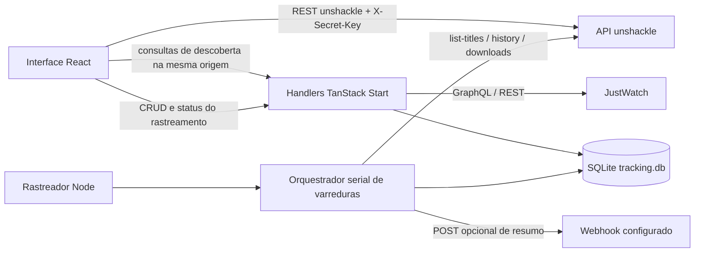
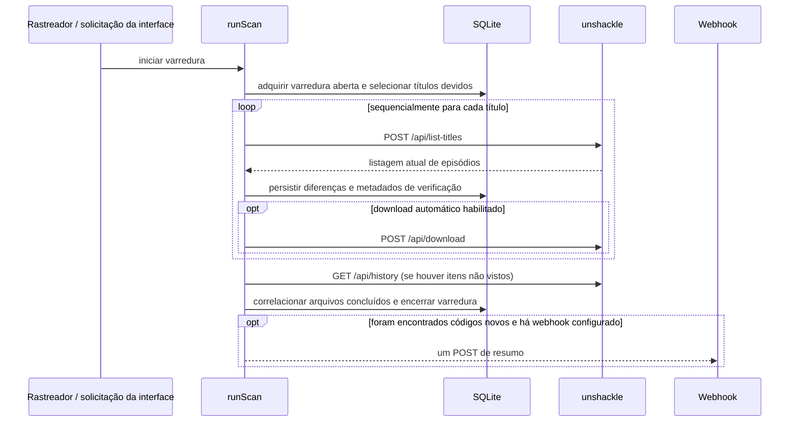

# Arquitetura

## Visão geral

O repositório compila uma aplicação TanStack Start com dois contextos de execução:

1. Uma interface React renderizada no servidor e hidratada no navegador.
2. Handlers de rotas e um processo Node que serve os arquivos compilados, mantém
   o estado de rastreamento em SQLite, consulta unshackle/JustWatch e executa o
   rastreador em segundo plano.

O navegador chama diretamente a API unshackle configurada para os fluxos
principais. O endereço-base e a chave vêm das configurações do navegador/local
storage ou de valores opcionais `PUBLIC_*` incorporados no build. Os handlers
`/api/browse/*`, na mesma origem, fazem proxy para o JustWatch. Os handlers
`/api/tracking/*` operam no SQLite do servidor da interface; o rastreador usa um
cliente unshackle separado, configurado em runtime.

## Componentes

| Componente                                  | Responsabilidade                                                                                     |
| ------------------------------------------- | ---------------------------------------------------------------------------------------------------- |
| `src/routes/*.tsx`                          | Interface de descoberta, título, downloads, histórico, rastreamento e configurações.                 |
| `src/routes/api.browse.*`                   | Validar parâmetros de descoberta e consultar o JustWatch via proxy.                                  |
| `src/routes/api.tracking.*`                 | CRUD do rastreamento, início de varredura, status e configurações do servidor.                       |
| `src/lib/api/client.ts`                     | Requisições REST do navegador ao unshackle, autenticação e URL de SSE.                               |
| `src/lib/api/jobEvents.ts`                  | Coordenação de eventos de jobs no navegador e atualização de dados.                                  |
| `src/lib/browse/match.ts`                   | Associar ofertas JustWatch a serviços unshackle e normalizar links.                                  |
| `src/server/justwatch.ts`                   | Chamadas GraphQL/REST ao JustWatch e cache em memória do processo.                                   |
| `src/server/config.ts`, `settings.ts`       | Configuração de runtime, substituições no SQLite e informação de origem.                             |
| `src/server/db.ts`                          | Esquema SQLite, migrações, propriedade dos registros e estado das varreduras.                        |
| `src/server/poller.ts`, `scan.ts`           | Verificações periódicas devidas e orquestração serial de varreduras.                                 |
| `src/server/detect/series.ts`               | Comparar listagem atual de episódios com códigos armazenados.                                        |
| `src/server/history.ts`, `auto-download.ts` | Correlacionar downloads concluídos e montar solicitações automáticas.                                |
| `src/server/webhook.ts`                     | Notificação resumida não bloqueante quando a varredura encontra novidades.                           |
| `server-runner.mjs`                         | Servidor HTTP Node que serve `dist/client` e encaminha outras requisições ao handler fetch do Start. |

## Inicialização e fluxos

### Build e inicialização do servidor

O Vite usa os plugins do TanStack Start, React e Tailwind. `npm run build` gera
`dist/client` e um handler fetch em `dist/server/server.js`, não um listener HTTP
autônomo. `server-runner.mjs` inicia o listener, serve os recursos estáticos e
encaminha as demais requisições ao handler. Na inicialização, `src/server.ts`
abre/inicializa o SQLite, carrega substituições persistidas e inicia o rastreador.
As proteções em `globalThis` para a conexão de banco e o rastreador evitam
duplicações durante o HMR de desenvolvimento.

### Download

O navegador armazena as configurações da API localmente e chama a API REST do
unshackle, enviando `X-Secret-Key` quando há uma chave configurada. A interface
pesquisa serviços e títulos, obtém detalhes e faixas, converte as opções
selecionadas em solicitações à API, inicia jobs e acompanha eventos/status. As
operações de fila e o histórico também chamam endpoints do unshackle diretamente.
Loaders de rota que dependam da API exclusiva do navegador devem evitar SSR, pois
a renderização no servidor não tem acesso às configurações do local storage.

### Rastreamento

1. Uma rota cria um registro de série e insere os códigos de episódio conhecidos
   numa transação SQLite. Os registros são associados à chave
   `X-Secret-Key` usada na criação; sem chave, o proprietário literal é
   `anonymous`. Registros legados com proprietário `NULL` são compartilhados.
2. O processo verifica a cada minuto. A cada ciclo, seleciona no SQLite janelas de
   lançamento e retries vencidos; títulos configurados são consultados um a um,
   com intervalo ajustável entre chamadas upstream.
3. `runScan` é o fluxo comum para disparos periódicos, manuais e por atraso. Mantém
   um único registro de varredura aberto como trava, atualiza o estado dos títulos
   e encerra a varredura com totais. Falhas individuais ficam em `last_error`.
4. A detecção de séries chama `POST /api/list-titles` do unshackle, deriva códigos
   de episódio e persiste adições, retornos e desaparecimentos sem apagar linhas
   históricas. Códigos novos podem ser enviados para `POST /api/download`.
5. Arquivos do histórico de downloads concluídos podem marcar itens como vistos; o
   aplicativo reutiliza o reconhecedor de nomes de arquivo usado pela interface.
   Também há ações manuais para marcar itens como vistos.
6. Uma varredura concluída com códigos novos pode enviar um resumo JSON opcional
   ao webhook. A entrega não é repetida nem bloqueia a varredura.

## Integrações e dependências

- **API REST unshackle:** necessária para busca e download. O navegador usa as
  próprias configurações; o rastreador usa as configurações do servidor. Elas
  podem divergir intencionalmente. Os endpoints utilizados estão em
  [docs/API.md](docs/API.md).
- **JustWatch:** as consultas de descoberta são feitas no servidor porque a API
  remota não fornece cabeçalhos CORS para uso direto pelo navegador. São usados
  GraphQL e um endpoint de URL para países do título, sem chave de API. Falhas são
  convertidas em respostas da API; os dados de descoberta são armazenados em
  cache na memória do processo.
- **SQLite (`node:sqlite`):** armazenamento local durável para títulos rastreados,
  estado de episódios, varreduras e metadados de configuração. Não há serviço de
  banco de dados externo ou fila.
- **Webhook:** POST JSON genérico opcional, um por varredura com códigos novos,
  timeout de 10 segundos e sem fila de retries.
- **Pacotes de runtime:** React 19, TanStack Start/Router/Query, Vite 8, Tailwind
  CSS 4, TypeScript 6 e Vitest 4 são declarados em `package.json`. Recursos HTTP,
  SQLite, criptografia e sistema de arquivos usam módulos nativos do Node.

## Decisões arquiteturais identificadas no código

- O rastreamento é executado no próprio processo porque o servidor da interface é
  dono do armazenamento SQLite; a inicialização ocorre em `src/server.ts`, não
  sob demanda numa rota.
- As varreduras são serializadas intencionalmente porque a listagem upstream é uma
  operação ao vivo e custosa; há apenas uma varredura e as chamadas por título
  são sequenciais.
- As configurações do servidor e do navegador são distintas porque tarefas em
  segundo plano não acessam o local storage. Substituições editáveis do servidor
  são armazenadas no SQLite.
- O proxy do JustWatch fica no servidor para contornar a restrição CORS do
  navegador.
- Códigos que desapareceram permanecem armazenados para preservar o histórico.

## Limites e aspectos não verificados

- O repositório não contém worker separado, fila de mensagens, banco externo,
  serviço de autenticação ou configuração de proxy reverso.
- O armazenamento aceita vários tipos de rastreamento, mas a API implementa
  somente séries. Não se deve inferir que filmes/buscas funcionam pelos tipos
  compartilhados.
- O comportamento com instalações reais de unshackle ou JustWatch não foi
  exercitado nesta análise.
- O contrato completo da API externa não está incluído; consulte
  [docs/API.md](docs/API.md) para os caminhos usados pela interface e o serviço
  upstream para os esquemas completos.
